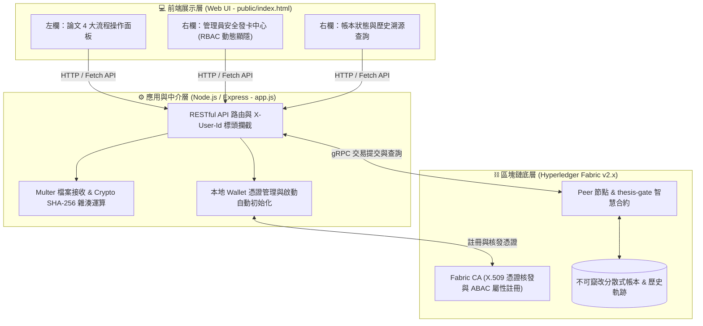
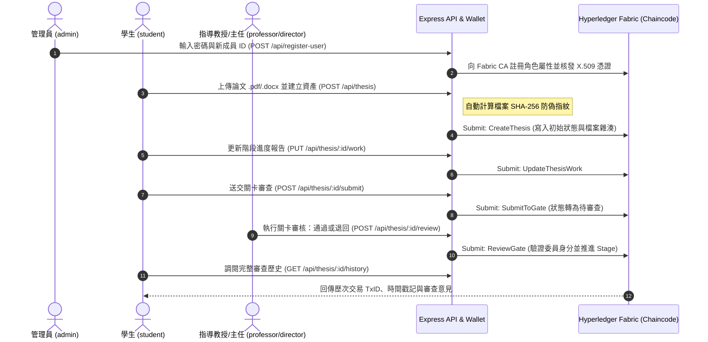

# 🎓 Thesis-GATE v2.0：基於 Hyperledger Fabric 之區塊鏈學術論文審查與防偽系統

**Thesis-GATE v2.0** 是第二代學術論文審查流程管理與防偽驗證系統。本版本從概念驗證（PoC）全面升級為基於 **Hyperledger Fabric 聯盟鏈、Fabric CA 數位憑證與 Node.js 全端架構** 的實戰級系統，將新產品開發（NPD）之「Stage-Gate 關卡審查機制」與密碼學雜湊防偽技術深度結合。

---

## 🏗️ 系統整體架構 (System Architecture)

本系統採用三層式架構設計，透過 Express 統一託管前端與 RESTful API，並以 gRPC 協定與底層區塊鏈節點進行高效通訊：



---

## 🔄 論文審查與防偽流程 (Workflow & State Machine)



---

## 🚀 v2.0 四大核心技術總結

### 1. 真實 PKI 數位憑證與管理員安全發卡中心 (RBAC / ABAC)
淘汰傳統靜態帳密，串接 Fabric CA 核發 X.509 數位憑證並儲存於本地 `wallet/`。實作前端視圖保護（僅切換為 admin 時顯示發卡中心）與後端 CA 管理員密碼雙重驗證，動態註冊具備角色屬性（student / professor / director）之新成員。

### 2. 論文實體檔案 SHA-256 防偽指紋上鏈
採用「鏈下儲存檔案、鏈上紀錄指紋」之區塊鏈最佳實踐。支援 `.docx` 與 `.pdf` 檔案上傳，於後端記憶體即時運算 64 位元 SHA-256 雜湊值並寫入帳本，徹底杜絕審查後抽換論文版本之風險。

### 3. Stage-Gate 審查狀態機與完整歷史溯源 (Provenance)
透過智慧合約嚴格控管「創建 ➔ 更新進度 ➔ 送交 Gate ➔ 委員審核」之生命週期。整合區塊鏈 `GetHistoryForKey` 機制，一鍵調閱單一論文自創建以來的所有交易紀錄、時間戳記與審查批註。

### 4. 全自動化環境部署與高可用性設計
內建 `ensureDefaultUsers()` 自動初始化機制，伺服器啟動時自動檢核並建立預設測試角色（admin、student1、S1129915、professor1、director1）。配備 `start-all.sh` 一鍵自動化腳本，整合底層網路重置、通道建立、合約部署、錢包同步與 WSL 2 內部 IP 自動偵測。

---

## ⚡ 快速啟動指南 (Quick Start)

本專案提供全自動化啟動腳本，支援於 WSL 2 (Ubuntu) 環境下一鍵運行：

**1. 日常快速啟動（底層區塊鏈已運行時）**

```bash
chmod +x start-all.sh
./start-all.sh
```

**2. 完整重置並重新部署（從零建立網路、部署合約與刷新錢包）**

```bash
./start-all.sh --reset
```

啟動後，終端機將自動顯示當前 WSL 內部連線網址（例如 `http://172.x.x.x:3000`），直接於瀏覽器開啟即可進入系統。

---

## 📂 專案目錄結構

```text
thesis-gate-api/
├── chaincode/                  # 🔗 智慧合約層
│   ├── lib/
│   │   └── assetTransfer.js    # 核心區塊鏈合約邏輯 (含 putState 與 SHA-256 雜湊)
│   └── package.json            # 鏈碼相依設定
├── public/                     # 💻 前端展示層
│   └── index.html              # 雙欄式響應式前端介面 (RBAC 動態選單與四大流程面板)
├── wallet/                     # 🔒 本地 X.509 數位憑證錢包 (已加入 .gitignore，啟動時自動生成)
├── app.js                      # ⚙️ Express API 伺服器、gRPC 連線通道與 SHA-256 雜湊邏輯
├── start-all.sh                # 🚀 一鍵自動化部署與啟動腳本 (支援 --reset 模式)
├── package.json                # Node.js 專案相依套件設定
└── README.md                   # 📄 專案技術文件與架構總結
```
---

## 🌟 v2.1 核心功能亮點

1. **嚴謹的 NPD Stage-Gate 流程管控**
   - 完整實現 6 個研發階段與 5 道嚴格關卡（Gate 1、2、4 由指導教授審查；Gate 3、5 由系所主任審查）。
   - 結合 SHA-256 檔案數位指紋防偽，確保上傳的論文內容無法被私自竄改。

2. **基於憑證屬性 (ABAC/ACL) 的身分權限過濾**
   - **學生**：僅能建立與更新自己名下的論文、上傳進度，並在填寫報告後送交審查。
   - **指導教授 / 系所主任**：僅能針對被綁定指派的論文進行對應 Gate 的審查（通過/退回）。
   - **系統管理員 (Admin)**：具備專屬發卡中心與特權管理介面。

3. **🔄 v2.1 全新功能：管理員鏈上委員更換與代理授權 (ReassignReviewer)**
   - 針對真實校園行政中「指導教授或系主任因故無法審核、離職、或建檔代號誤填（如 D001）」的緊急狀況。
   - 管理員可透過後台安全執行委員變更，將異動原因與 Admin 簽章永久寫入區塊鏈稽核軌跡（`GetThesisHistory`），完美兼顧行政彈性與區塊鏈不可篡改精神。

4. **強固的前後端架構與錯誤防禦**
   - 採用 Node.js Express 結合 Hyperledger Fabric Gateway v1.0 SDK。
   - 前端導入動態身分切換、發卡中心顯隱控制，以及完善的伺服器回傳格式異常防禦。

---

## 🛠️ 快速啟動指南

### 1. 啟動區塊鏈網路與 API 伺服器
```bash
cd ~/fabric-samples/thesis-gate-api
./start-all.sh --reset
